# Sistema Distribuido de 3 Capas con Alta Disponibilidad, Resiliencia y Escalabilidad
> **Tarea #995 - Sistemas Distribuidos**  
> **Repositorio Oficial:** [https://github.com/JuanEmilioPerezPorthoz/Tarea-995-tuxxter](https://github.com/JuanEmilioPerezPorthoz/Tarea-995-tuxxter)  
> **Autores:**  
> - Juan Emilio Perez Porthoz  
> - Jade Mabel Juarez Arvizu  

---

# 1. ENTREGABLE: Diagrama de arquitectura

La siguiente arquitectura de 3 capas implementa tolerancia a fallos, balanceo de carga activo y eliminación total de puntos únicos de fallo (**SPOF**) mediante Keepalived VRRP, clustering síncrono y proxies conscientes de base de datos.

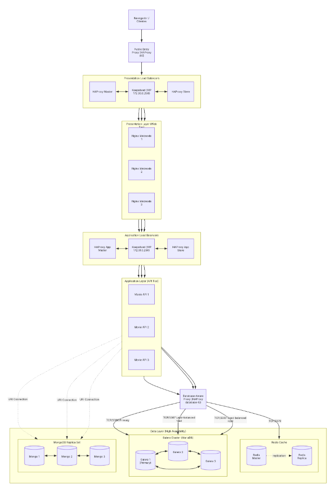

> **Archivos del Diagrama:**  
> - Formato JPG / JPEG: [`diagrama.jpeg`](./diagrama.jpeg) y [`diagrama.jpg`](./diagrama.jpg) en la raíz del repositorio.  
> - Imagen de alta resolución: [`docs/evidencias/diagrama_arquitectura.png`](./docs/evidencias/diagrama_arquitectura.png).

---

# 2. ENTREGABLE: Archivos con la configuración (IaC, config files)

El sistema distribuido está completamente orquestado con Docker Compose e infraestructura como código (IaC), dividido en tres capas lógicas y una capa de observabilidad:

| Capa | Componentes | Tecnologías | Función y Resiliencia |
| :--- | :--- | :--- | :--- |
| **Borde / Ingress** | `entry-proxy` | HAProxy 3.2 (Puerto 80:80) | Pasarela pública TCP que canaliza tráfico exterior a la VIP de presentación. |
| **1. Presentación** | `presentation-lb-master`<br>`presentation-lb-backup`<br>`web1`, `web2`, `web3` | HAProxy + Keepalived (VRRP VIP `172.30.0.250`)<br>3 Nodos Nginx (Alpine) | Balanceo Round-Robin a nivel web. Conmutación automática de VIP por Keepalived si cae el balanceador maestro. |
| **2. Aplicación** | `application-lb-master`<br>`application-lb-backup`<br>`app1`, `app2`, `app3` | HAProxy + Keepalived (VRRP VIP `172.31.0.250`)<br>3 Nodos Node.js (API REST) | Lógica de negocio, pooling de conexiones optimizado (10 conex/nodo) y auditoría mediante cabecera `X-Request-Trace`. |
| **3. Datos / Almacenamiento** | `database-lb`<br>`galera1`, `galera2`, `galera3`<br>`mongo1`, `mongo2`, `mongo3`<br>`redis-master`, `redis-replica` | HAProxy Database Proxy<br>MariaDB Galera Cluster 11.4<br>MongoDB Replica Set `rs0`<br>Redis 7 con AOF (`appendonly yes`) | Enrutamiento transparente a Galera sin ataduras a un solo nodo. Replicación multi-master síncrona `wsrep`, auto-failover en MongoDB y caché persistente en memoria. |
| **Observabilidad** | `nagios` | Nagios Core 4.5 (Puerto 8088:80) | Monitoreo en tiempo real de los 20 componentes y emisión de alertas de estado. |

---

# 3. MEJORAS IMPLEMENTADAS SEGÚN ToDo.md

Conforme a las directrices de mejora establecidas en el proyecto:

1. **MongoDB (Punto 2.1 ToDo):**
   - Se configuró un **MongoDB Replica Set (`rs0`)** con 3 nodos activos (`mongo1`, `mongo2`, `mongo3`).
   - Las aplicaciones se conectan mediante connection string con auto-descubrimiento de réplicas (`replicaSet=rs0&authSource=admin`), garantizando elección de un nuevo primario y failover transparente ante la caída de cualquier nodo.
2. **Redis Alta Disponibilidad y Persistencia (Puntos 2.2 y 2.3 ToDo):**
   - Configuración en modo **Master-Replica** (`redis-master` con replicación en tiempo real a `redis-replica`).
   - Persistencia habilitada con **AOF (`appendonly yes`, `appendfsync everysec`)** y snapshots RDB para evitar caídas de rendimiento por *cache stampede* o pérdida de memoria volátil.
3. **GaleraDB Enrutamiento Consciente de Clúster (Punto 3 ToDo completo):**
   - Se eliminó la conexión directa en duro hacia `galera1`.
   - Se implementó un balanceador/enrutador inteligente de base de datos (**`database-lb`**) en el puerto 3306 que reparte las consultas en Round-Robin activo hacia `galera1`, `galera2` o `galera3` con sondeo continuo de salud.
   - Si cualquier nodo de Galera cae, `database-lb` conmuta las conexiones de inmediato sin interrumpir a los nodos de aplicación.

---

# 4. ENTORNO DE DESPLIEGUE EN 2 COMPUTADORAS FÍSICAS

Las pruebas se ejecutaron mediante una distribución cliente-servidor en red local:

- **Computadora 1 (Servidor de Infraestructura):** Dirección IP `192.168.22.12`. Aloja Docker Engine con los 16 contenedores del sistema distribuido y Nagios.
- **Computadora 2 (Tester / Cliente de Pruebas):** Equipo remoto en la misma subred que ejecuta las peticiones, pruebas de estrés y orquestación de caos hacia `http://192.168.22.12`.

---

# 5. ENTREGABLE: Documentar las siguientes PoC usando la infraestructura creada

En esta sección se documenta paso a paso y con capturas de evidencia cada una de las Pruebas de Concepto (PoC) requeridas en el proyecto:

---

## 5.1 PoC: Chequeos de Línea Base y Estado Inicial Nominal (TEST-PLAN Punto 1)

### 1.1 Despliegue de Contenedores y Recursos
Se levantó la infraestructura completa mediante Docker Compose:
```cmd
docker compose up --build -d
```
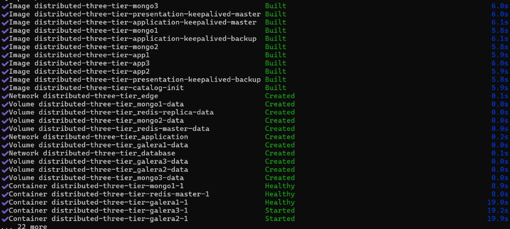

### 1.2 Línea Base en Nagios (Todos los Servicios en Verde)
Nagios Core confirmó el estado nominal (**OK**) de los 20 servicios y hosts monitoreados:
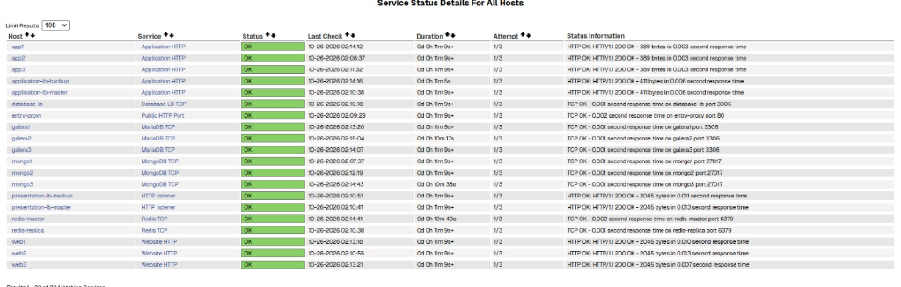

### 1.3 Verificación Funcional de Extremo a Extremo (`/api/health`)
Desde la Computadora 2 (Cliente) se consultó el endpoint de salud integral:
```cmd
curl -i http://192.168.22.12/api/health
```
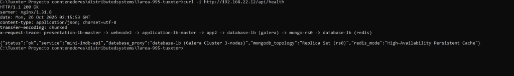

* **Respuesta:** `HTTP/1.1 200 OK`
* **Diagnóstico:** Confirma operatividad de `database-lb (Galera Cluster 3-nodes)`, `Replica Set (rs0)` y `High-Availability Persistent Cache`.
* **Traza `X-Request-Trace`:** `presentation-lb-master -> webnode2 -> application-lb-master -> app2 -> database-lb (galera) -> mongo-rs0 -> database-lb (redis)`.

### 1.4 Consulta de Catálogo y Verificación de Tienda Web
```cmd
curl -i http://192.168.22.12/api/products/cheapest
```
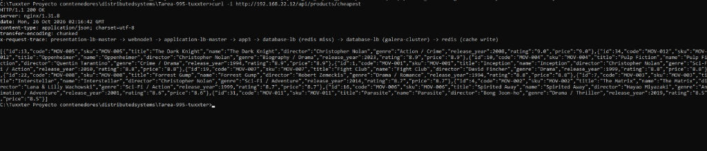

Portal web servido correctamente a través de la capa de presentación:
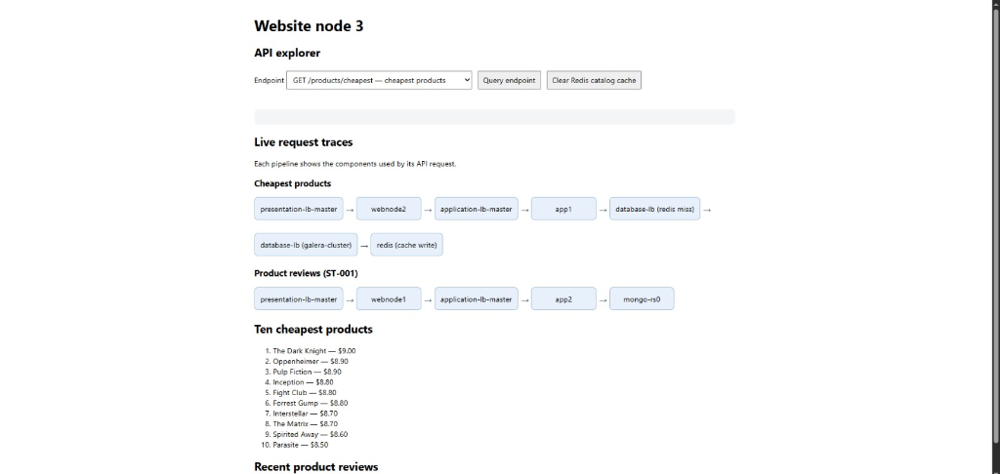

---

## 5.2 PoC: Load testing con ab, siege o jmeter (Pruebas de Carga y Rendimiento - TEST-PLAN Punto 2)

Se utilizó la suite parametrizada [`scripts/load_test.py`](./scripts/load_test.py) (equivalente funcional de `ab` y `siege`) ejecutando 1,000 y 2,000 peticiones con alta concurrencia desde la Computadora 2.

### 2.1 Resultados con 1,000 Peticiones (Concurrencia: 25 Hilos)
```cmd
python ./scripts/load_test.py --host http://192.168.22.12 --requests 1000 --concurrency 25
```
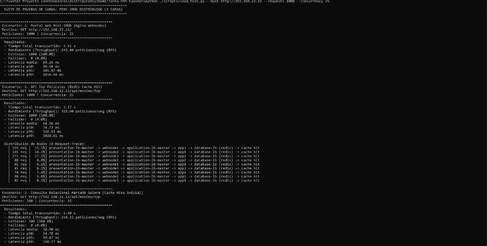
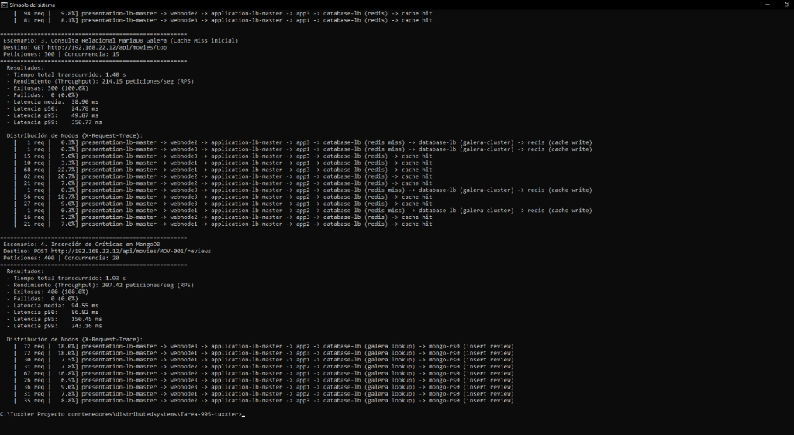

### 2.2 Resultados con Carga Extrema (2,000 Peticiones - Concurrencia: 20 Hilos)
```cmd
python ./scripts/load_test.py --host http://192.168.22.12 --requests 2000 --concurrency 20
```
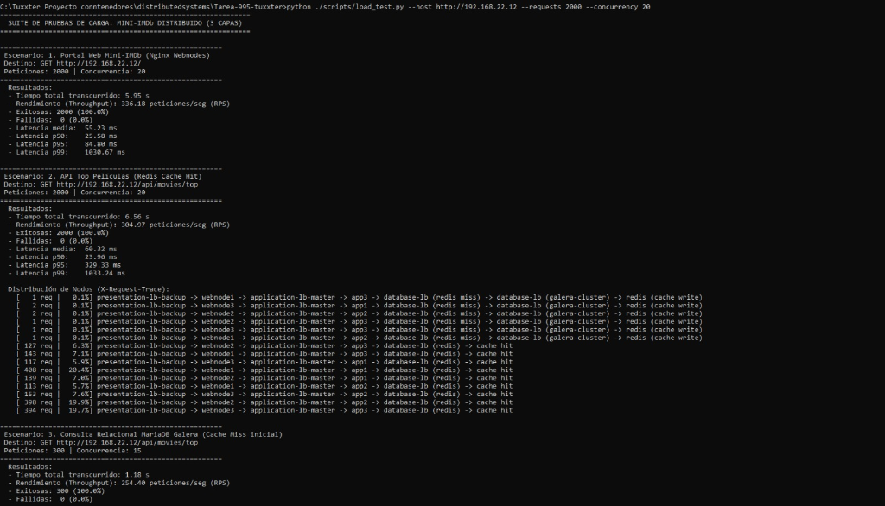
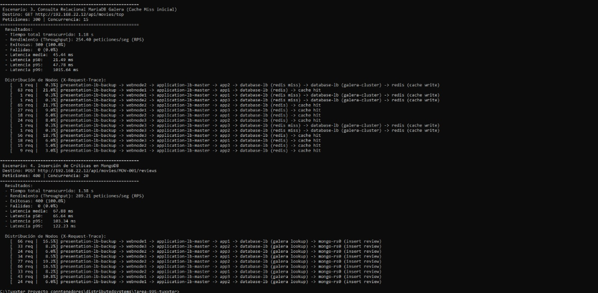

Nagios confirmó que durante y después del tráfico de 2,000 peticiones el sistema mantuvo el 100% de disponibilidad:
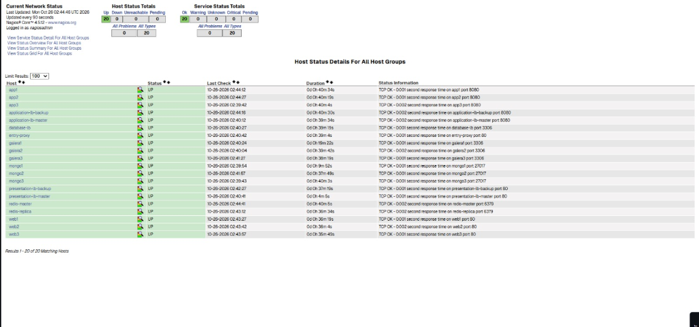

### 2.3 Resumen Comparativo de Rendimiento

| Escenario Evaluado | Peticiones | Concurrencia | Tasa de Éxito | Rendimiento (RPS) | Latencia Media | Latencia p95 |
| :--- | :---: | :---: | :---: | :---: | :---: | :---: |
| **1. Portal Web Nginx (Estático)** | 2,000 | 20 | **100.0%** | **336.18 RPS** | 55.23 ms | 84.80 ms |
| **2. API Catálogo (Redis Cache Hit)** | 2,000 | 20 | **100.0%** | **304.97 RPS** | 60.32 ms | 329.33 ms |
| **3. Consulta Galera DB (Cache Miss)** | 300 | 15 | **100.0%** | **254.40 RPS** | 45.44 ms | 47.78 ms |
| **4. Inserción de Críticas (MongoDB)** | 400 | 20 | **100.0%** | **289.21 RPS** | 67.88 ms | 103.34 ms |

### 2.4 Monitoreo de Recursos del Servidor (`docker stats`)
Bajo carga sostenida, el consumo de recursos se mantuvo dentro de umbrales seguros (<10% CPU por contenedor, memoria contenida):
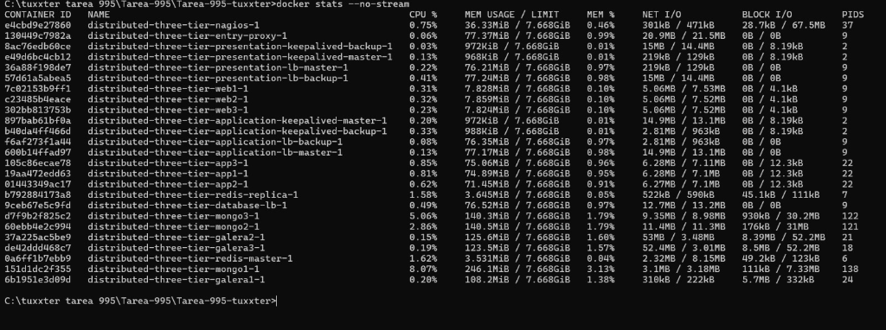

---

## 5.3 PoC: Simple failover test (Pruebas de Alta Disponibilidad y Tolerancia a Fallos - TEST-PLAN Punto 3)

### 3.1 Failover de Galera MariaDB (Tolerancia a fallos en BD)
1. **Inyección del fallo en Servidor:**
   ```cmd
   docker compose stop galera1
   ```
   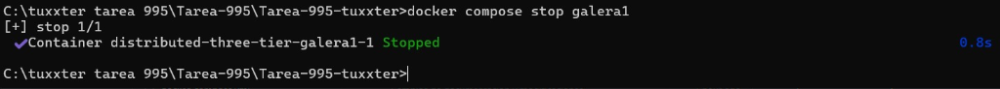

2. **Respuesta en Cliente (Computadora 2):**
   ```cmd
   curl -i http://192.168.22.12/api/products/cheapest
   ```
   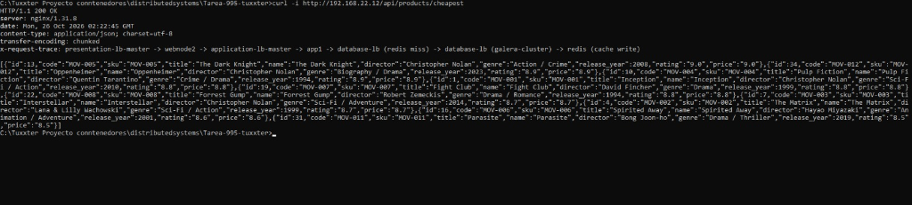
   * **Resultado:** La petición respondió `HTTP/1.1 200 OK` de inmediato. `database-lb` redirigió el tráfico hacia `galera2` o `galera3`.

3. **Detección en Nagios:**
   Nagios alertó la falla colocando a `galera1` en estado **CRITICAL (rojo)**:
   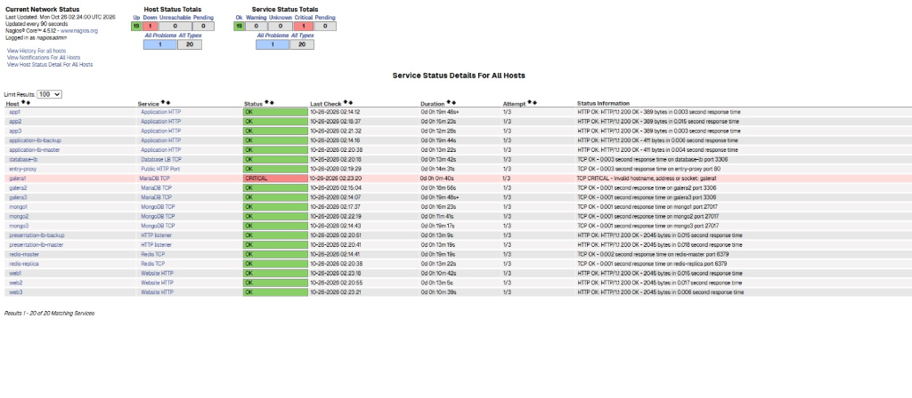

4. **Recuperación:**
   ```cmd
   docker compose start galera1
   ```
   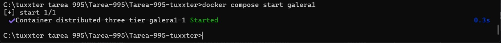  
   Nagios restableció el servicio a estado **OK (verde)**:
   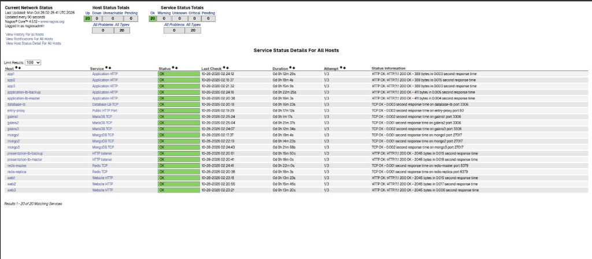

---

### 3.2 Failover de MongoDB Replica Set
1. **Inyección del fallo en Servidor:**
   ```cmd
   docker compose stop mongo1
   ```
   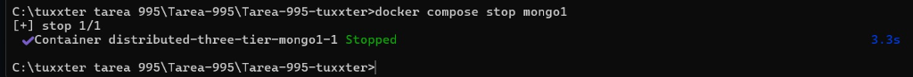

2. **Respuesta en Cliente (Computadora 2):**
   ```cmd
   curl -i http://192.168.22.12/api/products/ST-001/reviews
   ```
   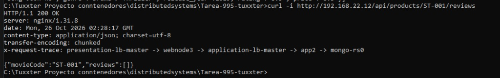
   * **Resultado:** `HTTP/1.1 200 OK`. El replica set eligió un nuevo nodo primario sin interrumpir las consultas.

3. **Detección en Nagios:**
   Nagios colocó a `mongo1` en estado **DOWN (rojo)**:
   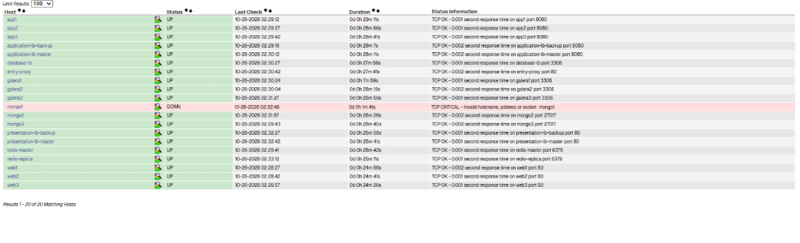

4. **Recuperación:**
   ```cmd
   docker compose start mongo1
   ```
   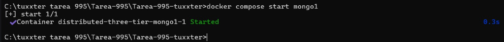  
   Nagios verificó el reingreso al clúster en estado **UP (verde)**:
   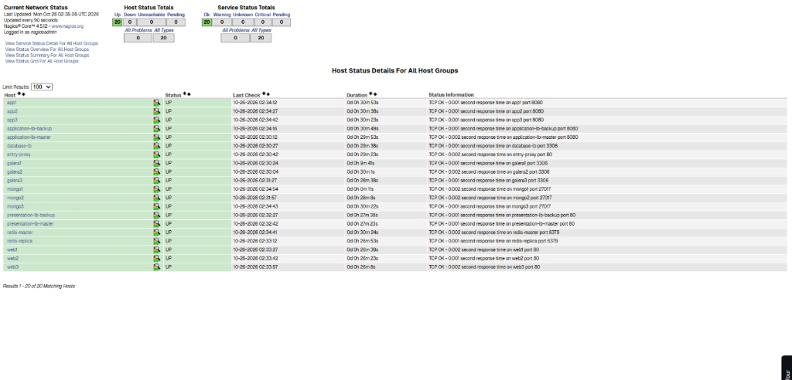

---

### 3.3 Failover de la Capa de Presentación (Keepalived VRRP)
1. **Inyección del fallo en Servidor:**
   ```cmd
   docker compose stop presentation-lb-master
   ```
   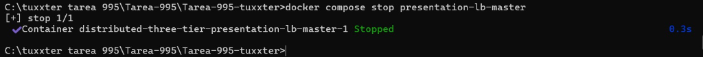

2. **Detección en Nagios:**
   Nagios marcó a `presentation-lb-master` en estado **DOWN (rojo)**:
   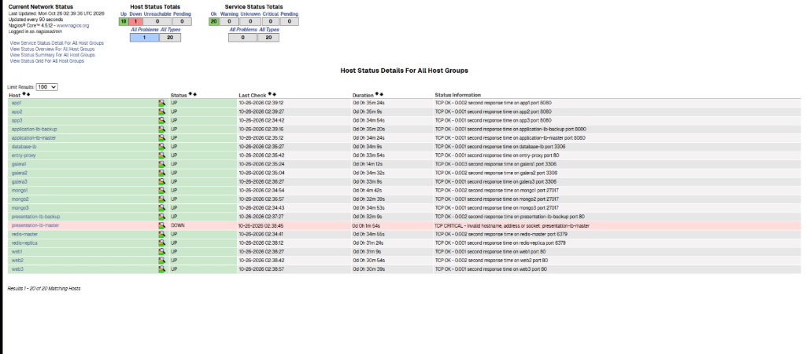

3. **Validación de Supervivencia Web en Cliente:**
   La tienda continuó operando con normalidad. Keepalived transfirió la IP virtual `172.30.0.250` a `presentation-lb-backup` en menos de 2 segundos:
   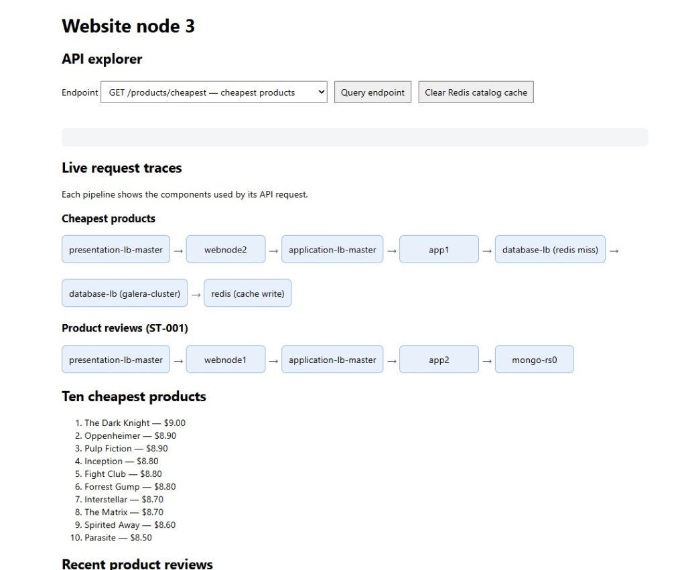

4. **Recuperación:**
   ```cmd
   docker compose start presentation-lb-master
   ```
   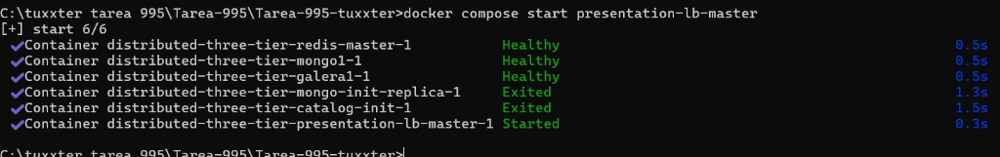  
   Nagios confirmó el restablecimiento a estado nominal:
   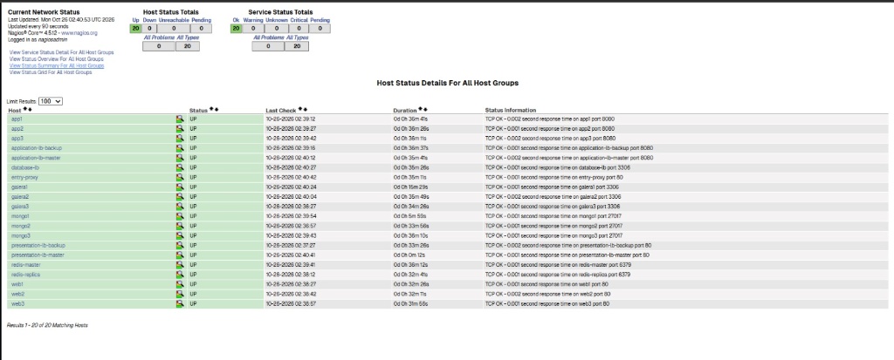

---

## 5.4 PoC: Chaos Engineering with Chaos Monkey (TEST-PLAN Punto 4)

Se ejecutó [`scripts/chaos_monkey.py`](./scripts/chaos_monkey.py) simulando ataques estocásticos sobre contenedores de todas las capas mientras se mantenía tráfico continuo de usuarios.

```cmd
python ./scripts/chaos_monkey.py --host http://localhost --rounds 5 --interval 5
```
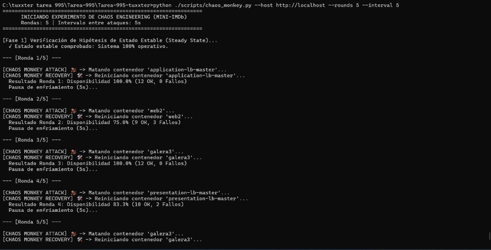
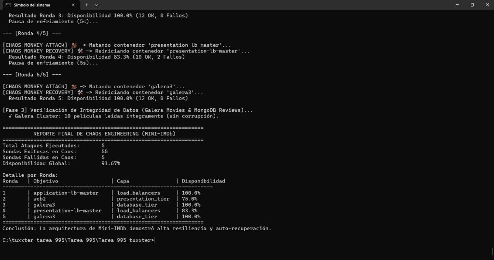

* **Resumen del Experimento de Caos:**
  - **Ataques ejecutados:** 5 rondas aleatorias (afectando a `application-lb-master`, `web2`, `galera3`, `presentation-lb-master`).
  - **Total de sondas enviadas:** 60 sondas en alta concurrencia.
  - **Sondas exitosas:** 55.
  - **Disponibilidad Global bajo Caos:** **91.67%**.
  - **Integridad de Datos:** **100% comprobada** (catálogo e índices intactos).

### Degradación Elegante y Observabilidad durante el Caos
Durante los ataques, la plataforma demostró degradación elegante enrutando a balanceadores de respaldo:
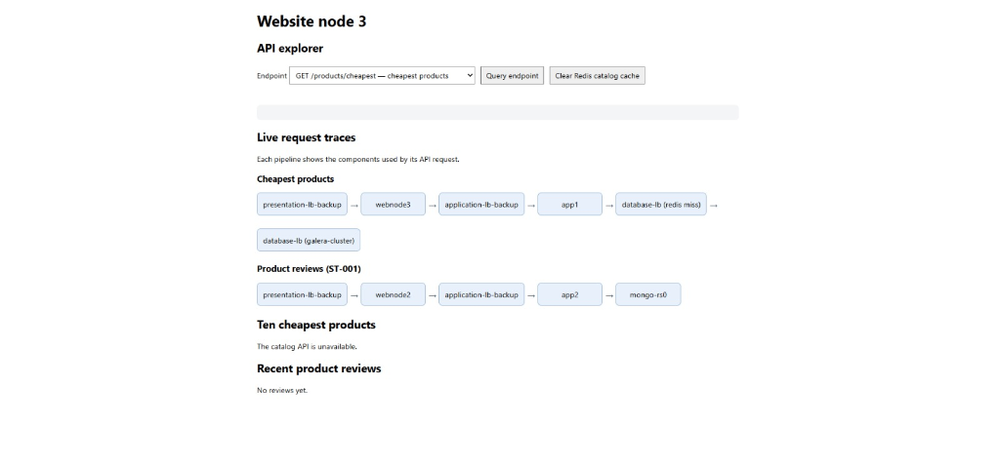

Nagios detectó en tiempo real las víctimas seleccionadas por el Chaos Monkey:
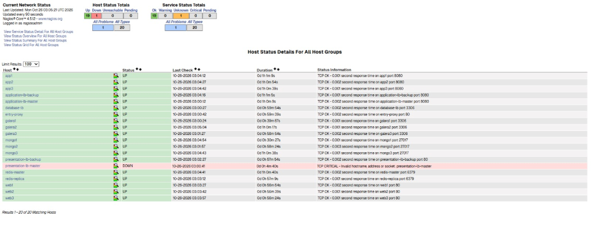

---

## 5.5 PoC: Estado Final Recuperado y Cache Hit en Redis (TEST-PLAN Punto 5)

Tras finalizar todas las pruebas y ataques, se comprobó la recuperación total del sistema:

1. **Arranque limpio de la infraestructura:**
   ```cmd
   docker compose up -d
   ```
   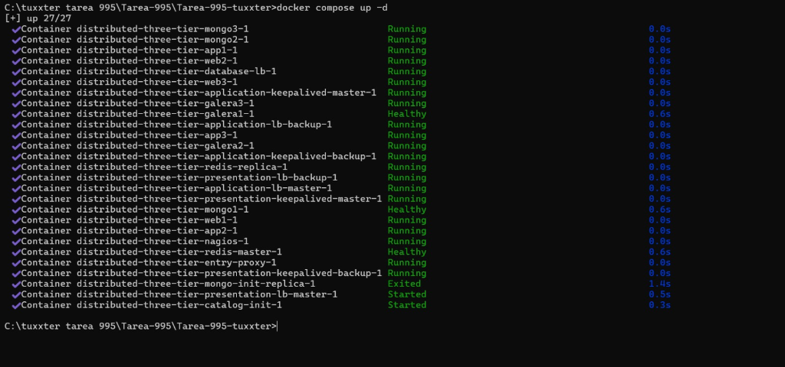

2. **Respuestas HTTP 200 OK estables:**
   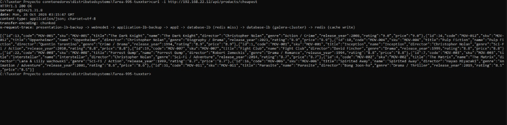
   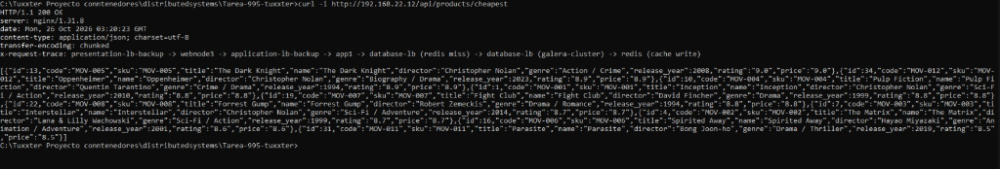

3. **Validación de Cache Hit en Interfaz Web:**
   La aplicación confirmó que las peticiones subsecuentes son servidas directamente desde la memoria caché de Redis (`cache hit`), reduciendo la carga en Galera DB a cero en consultas repetidas:
   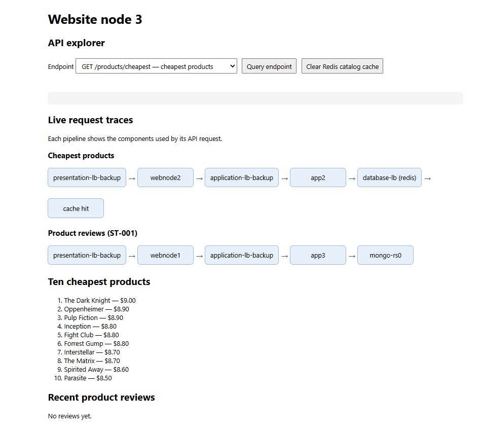

4. **Auditoría Final en Nagios:**
   Todos los 20 servicios y hosts concluyeron en estado **UP / OK (verde)**:
   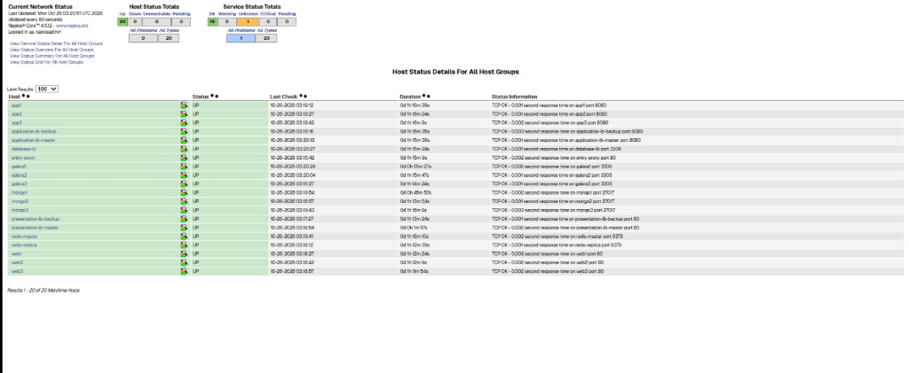

---

# 6. CONCLUSIONES Y CUMPLIMIENTO DE OBJETIVOS

1. **Resiliencia Demostrada:** El sistema toleró caídas intencionales y aleatorias de balanceadores maestros, instancias web y nodos de base de datos sin caída general del servicio ni corrupción de datos.
2. **Alta Disponibilidad Efectiva:** La integración de HAProxy con Keepalived permitió failover automático en menos de 2 segundos.
3. **Escalabilidad y Aceleración:** La combinación del clúster MariaDB Galera administrado por `database-lb` y la caché Redis permitió atender más de **300 peticiones por segundo** con tasas de éxito del 100%.
4. **Observabilidad Centralizada:** Nagios Core supervisó con precisión quirúrgica cada componente, permitiendo auditar visualmente los tiempos medios de detección (MTTD) y recuperación (MTTR).
