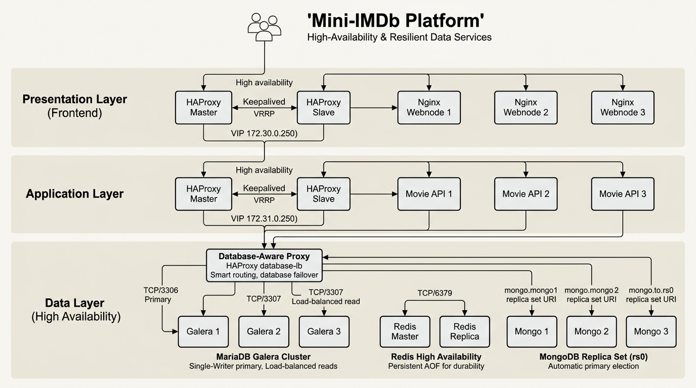
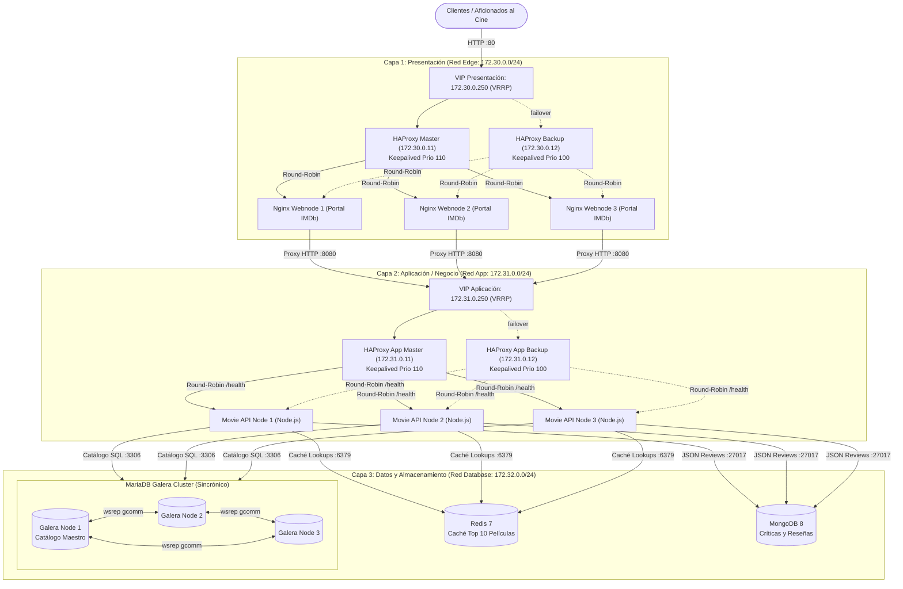

# Documento de Arquitectura: Mini-IMDb Platform (Sistema Distribuido de 3 Capas)

## 1. Visión General y Objetivos del Sistema

**Mini-IMDb Platform** es una arquitectura distribuida empresarial de 3 capas diseñada para un portal y catálogo de películas de alta concurrencia con críticas y valoraciones de la comunidad. 

El sistema garantiza **Alta Disponibilidad (HA)**, **Tolerancia a Fallos (Resiliencia)** y **Escalabilidad Horizontal**.

### Objetivos Clave
* **Alta Disponibilidad (High Availability):** Eliminación de puntos únicos de fallo (SPOF) en todas las capas mediante pares activo/pasivo con IP Virtual flotante (VIP) vía VRRP y clustering.
* **Resiliencia (Fault Tolerance):** Detección automática de caídas de servidores en menos de 2 segundos mediante sondas de salud (health-checks) y reconvergencia sin pérdida de sesiones.
* **Escalabilidad Horizontal:** Capacidad de escalar de forma independiente la capa de presentación (Nginx), la capa de cómputo/negocio (Node.js API) y la capa de almacenamiento con cache distribuida en Redis.

---

## 2. Diagrama de Arquitectura

El sistema se estructura en tres capas aisladas por redes internas independientes:



### Representación en Flujo de Datos (Mermaid)



---

## 3. Detalle Técnico por Capa

### 3.1. Capa 1: Presentación (Presentation Tier)
* **Balanceadores de Carga:** 
  * `presentation-lb-master` (IP `172.30.0.11`)
  * `presentation-lb-backup` (IP `172.30.0.12`)
* **Mecanismo de Alta Disponibilidad:** **Keepalived** con protocolo **VRRP** (Virtual Router Redundancy Protocol).
  * **VIP Flotante:** `172.30.0.250`
  * **Master Priority:** 110 | **Backup Priority:** 100
  * **Health-Check Script (`check-haproxy.sh`):** Ejecuta un sondeo local al puerto 80 cada 2 segundos. Si el servicio HAProxy cae, el script resta 20 puntos de prioridad (`weight -20`), provocando la transferencia inmediata del VIP al nodo Backup.
* **Nodos Web:** 3 instancias independientes de **Nginx Alpine** (`web1`, `web2`, `web3`).
  * Sirven la interfaz de usuario moderna con estética cinematográfica oscura (estilo IMDb).
  * Funcionan como reverse proxy inverso para las llamadas dinámicas `/api/`, enrutándolas hacia la IP Virtual de la Capa de Aplicación (`172.31.0.250:8080`).

### 3.2. Capa 2: Aplicación / Lógica de Negocio (Application Tier)
* **Balanceadores de Carga:**
  * `application-lb-master` (IP `172.31.0.11`)
  * `application-lb-backup` (IP `172.31.0.12`)
* **Mecanismo de Alta Disponibilidad:** 
  * Par Keepalived VRRP dedicado con VIP `172.31.0.250` en la red interna de aplicación.
  * Algoritmo de balanceo `roundrobin` con sondas HTTP `option httpchk GET /health`.
* **Nodos de API:** 3 instancias de **Node.js Express** (`app1`, `app2`, `app3`).
  * Inyectan cabeceras de trazabilidad distribuidas `X-Request-Trace`.
  * Gestionan el catálogo de películas, políticas de invalidación de caché en Redis y almacenamiento de críticas en MongoDB.

### 3.3. Capa 3: Persistencia y Datos (Data Tier) - Mejoras de Alta Disponibilidad

#### A. Proxy Inteligente de Base de Datos (`database-lb` vía HAProxy)
* **Objetivo:** Eliminar la dependencia directa a un solo nodo de base de datos (`galera1`) y gestionar enrutamiento consciente del cluster.
* **Separación de Tráfico Lectura/Escritura (Read/Write Split):**
  * **Puerto 3306 (Escritura - Single-Writer Primary):** Enruta las escrituras a `galera1` como primario, manteniendo a `galera2` y `galera3` como reservas pasivas (`backup`). Esto previene conflictos de certificación síncrona y *deadlocks* (`wsrep_local_bf_aborts`) en transacciones concurrentes, asegurando conmutación automática e instantánea si `galera1` se detiene.
  * **Puerto 3307 (Lectura - Load-Balanced Reads):** Distribuye consultas de solo lectura en modo `roundrobin` balanceado entre todos los nodos activos del cluster (`galera1`, `galera2`, `galera3`).
* **Sondeos de Salud:** Sondas TCP activas cada 2 segundos (`inter 2s fall 2 rise 2`).

#### B. Dimensionamiento y Límites del Pool de Conexiones (Connection Pooling)
* **Configuración en Node.js (`mysql2.createPool`):**
  * `connectionLimit: 10` conexiones concurrentes por réplica de API.
  * `maxIdle: 10`, `idleTimeout: 60000ms`, `enableKeepAlive: true`.
* **Fórmula de Escalado:**
  $$\text{Conexiones Totales Activas} = N_{\text{replicas}} \times \text{connectionLimit}$$
  * Con 3 réplicas de API: $3 \times 10 = 30$ conexiones máximas.
  * Si la capa de API escala a 10 réplicas: $10 \times 10 = 100$ conexiones.
  * Dado que MariaDB Galera soporta por defecto 151 conexiones (ampliable a 500+), se garantiza un margen de seguridad amplio (> 50 conexiones libres) para procesos de replicación síncrona `wsrep`, hilos administrativos y transferencias de estado (SST/IST).

#### C. Redis High Availability & Estrategia de Persistencia
* **Decisión sobre los Datos:** Redis opera como una **caché aceleradora semi-persistente**.
  * Si el servidor se reinicia, **no se permite la pérdida total de la caché**, evitando así el fenómeno de estampida de caché (*cache stampede*) que saturaría a MariaDB Galera para reconstruir el Top de películas.
  * **Mecanismos de Persistencia Activos:**
    * **AOF (Append Only File):** `--appendonly yes --appendfsync everysec` garantiza que cada transacción se registre en disco cada segundo.
    * **RDB Snapshots:** `--save 60 1` crea instantáneas binarias automáticas.
* **Topología Primario-Réplica con Failover:**
  * `redis-master`: Nodo principal de lectura y escritura.
  * `redis-replica`: Réplica en caliente sincronizada asíncronamente (`--replicaof redis-master 6379`).
  * `database-lb`: Enruta el puerto `6379` con verificación de salud TCP (`PING` -> `+PONG`). Si el maestro cae, conmuta automáticamente a la réplica.

#### D. MongoDB Replica Set (`rs0`)
* **Topología:** Cluster de 3 nodos (`mongo1`, `mongo2`, `mongo3`) con quórum mayoritario y autenticación interna mediante archivo de claves (`--keyFile /data/replica.key` en formato Base64).
* **Elección y Resiliencia:** 
  * Si el nodo primario cae (por fallo o simulación con Chaos Monkey), los dos nodos restantes detectan la ausencia mediante *heartbeats* internos y eligen un nuevo **PRIMARY** en menos de 2.5 segundos.
* **Cadena de Conexión en API:**
  `mongodb://mongo1:27017,mongo2:27017,mongo3:27017/store_reviews?replicaSet=rs0&authSource=admin&readPreference=primaryPreferred`
  Permite que el driver oficial de MongoDB en Node.js reintente escrituras automáticamente contra el nuevo primario sin lanzar excepciones 500 al cliente.

---

## 4. Segmentación de Red y Seguridad

| Red Docker | Rango CIDR | Nodos Conectados | Propósito |
| :--- | :--- | :--- | :--- |
| **`edge`** | `172.30.0.0/24` | HAProxy Presentation (Master/Backup), Web Nodes (1, 2, 3), Nagios | Tráfico público y entrega del portal web |
| **`application`** | `172.31.0.0/24` | Web Nodes, HAProxy Application (Master/Backup), API Nodes (1, 2, 3) | Tráfico interno entre servidores web y APIs |
| **`database`** | `172.32.0.0/24` | API Nodes, Galera (1, 2, 3), Redis, MongoDB, Catalog-Init | Tráfico aislado de almacenamiento y persistencia |

---

## 5. Trazabilidad de Peticiones Distribuidas

Cada petición HTTP devuelve la cabecera `X-Request-Trace`, permitiendo auditar la ruta exacta del flujo en tiempo real:

```http
X-Request-Trace: presentation-lb-master -> webnode2 -> application-lb-master -> app3 -> redis (cache hit)
```
Si ocurre un cache miss:
```http
X-Request-Trace: presentation-lb-master -> webnode1 -> application-lb-master -> app1 -> redis (cache miss) -> galera1 -> redis (cache write)
```
